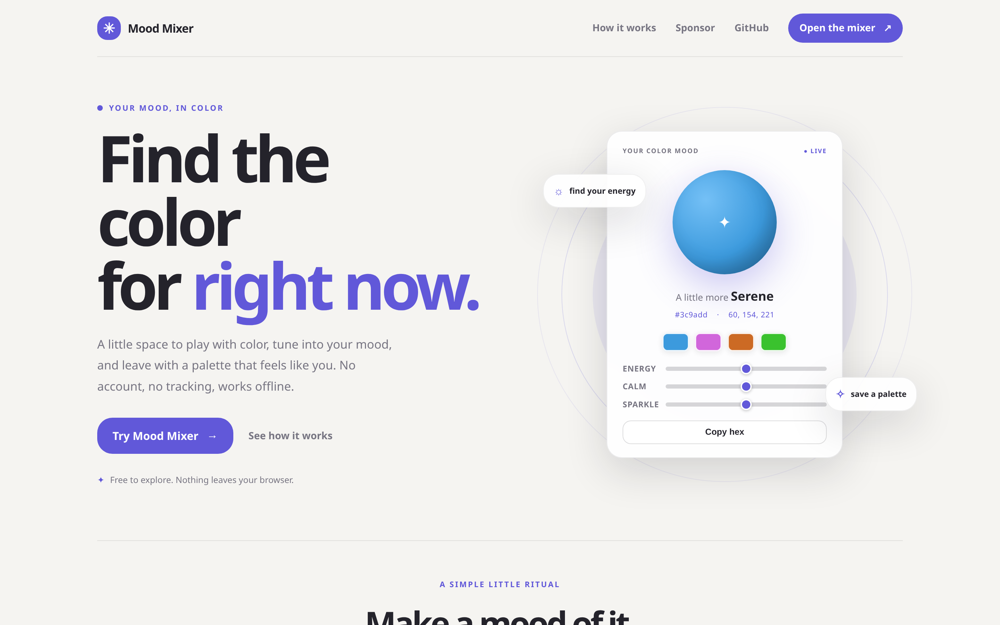
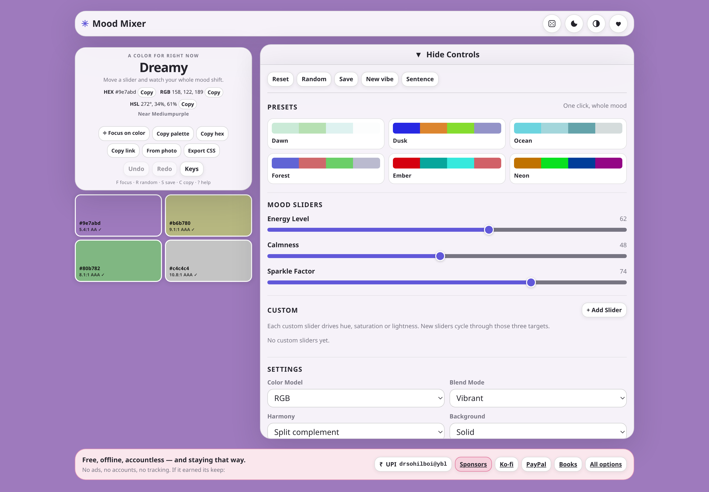
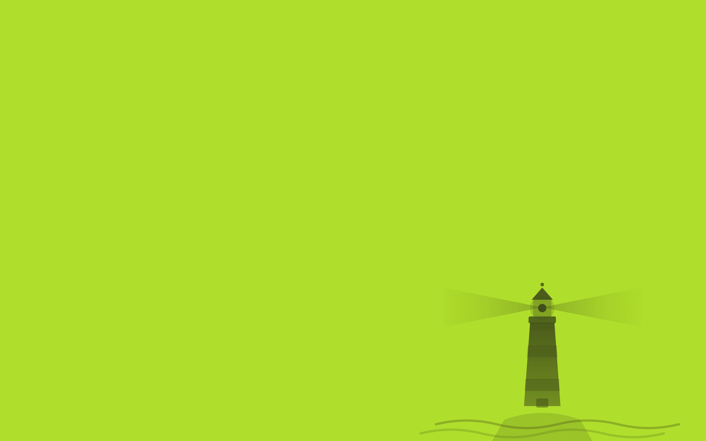
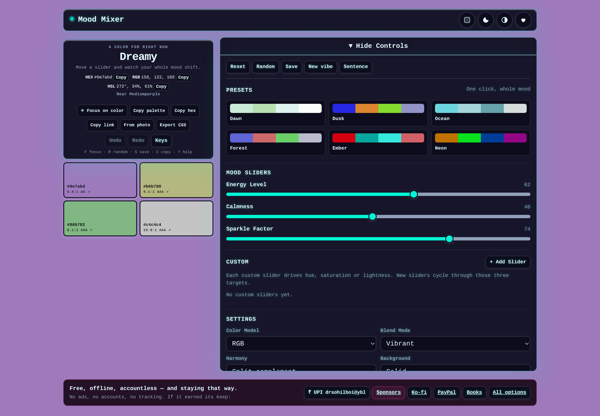
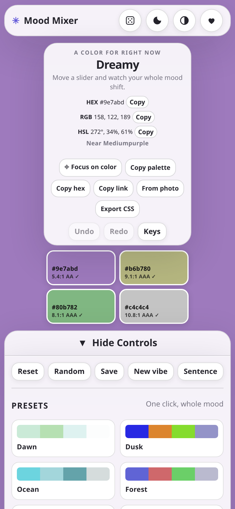
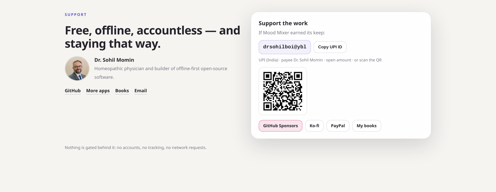

<div align="center">

# Mood Mixer

**Find the color for right now.**

A private, offline-ready color playground. Move three sliders, get a coordinated four-color palette, copy hex values, check WCAG contrast, and export what you like. No account, no analytics, no network calls.

[Live demo](https://drsamonline.github.io/mood-mixer/) · [Open the mixer](https://drsamonline.github.io/mood-mixer/mixer/) · [Report a bug](https://github.com/drsamonline/mood-mixer/issues) · [Changelog](CHANGELOG.md)

**Status: complete.** Version 2.19.1. Every feature listed below is shipped, tested in headless Chrome, lint-clean and deployed. Nothing is marked as planned or partial.

[](LICENSE)
[](https://github.com/drsamonline/mood-mixer/releases)
[](manifest.json)
[](service-worker.js)
[](#privacy)
[](color-core.js)
[](https://github.com/sponsors/drsamonline)
[](https://ko-fi.com/matneo)
[](#support)
[](https://github.com/drsamonline/mood-mixer/stargazers)

</div>

---

<!-- support:sweep -->
## Support


Free, offline, accountless — and staying that way. If it earned its keep:

| | |
|---|---|
| UPI (India) | `drsohilboi@ybl` — payee Dr. Sohil Momin, open amount, or scan [the QR](docs/assets/upi-qr.svg) |
| GitHub Sponsors | [github.com/sponsors/drsamonline](https://github.com/sponsors/drsamonline) |
| Ko-fi | [ko-fi.com/matneo](https://ko-fi.com/matneo) |
| PayPal | [paypal.me/drsohilmomin](https://paypal.me/drsohilmomin?locale.x=en_GB&country.x=IN) |
| My books | [Amazon author store](https://www.amazon.com/stores/author/B08ZT331LY/allbooks?ccs_id=aed72b9f-71d9-41dc-adee-e9368a317acc) |
| More apps | [drsamonline.github.io](https://drsamonline.github.io/) |
| Email | [sohilmomin2000@gmail.com](mailto:sohilmomin2000@gmail.com) |

Nothing is gated behind it: no accounts, no tracking, no network requests.

<div align="center">

[](https://github.com/sponsors/drsamonline)
[](https://ko-fi.com/matneo)
[](https://paypal.me/drsohilmomin?locale.x=en_GB&country.x=IN)
[](https://www.amazon.com/stores/author/B08ZT331LY/allbooks?ccs_id=aed72b9f-71d9-41dc-adee-e9368a317acc)

</div>

The same block is on the [landing page](https://drsamonline.github.io/mood-mixer/#support) and in the mixer's footer bar, with the UPI ID copyable and the QR scannable, so nobody has to open GitHub to support the work.

---

## Screenshots

| Landing page | Live mixer |
|---|---|
|  |  |

| Focus mode, lighthouse | Neon theme, dark UI |
|---|---|
|  |  |

| Mobile | Support block |
|---|---|
|  |  |

All captures are real renders of this repository at 1440×900, 1440×1000 and 390×844.

---

## What it does

- **Three sliders, one colour.** Energy, calmness and sparkle drive hue, saturation and lightness. Watch the whole palette move with them.
- **Six presets.** Dawn, Dusk, Ocean, Forest, Ember, Neon — one click sets the sliders, harmony and blend together.
- **Six harmony schemes.** Tetrad, complement, analogous, triad, split complement, monochrome.
- **Three colour models.** HSL, RGB and HSV, plus normal, vibrant, pastel and mono blend modes.
- **WCAG contrast on every swatch.** Each palette colour shows its best text colour and the ratio that goes with it, graded AA or AAA.
- **Custom sliders.** Add sliders that drive hue, saturation or lightness, rename them, remove them.
- **Locks.** Freeze hue, saturation or lightness and move everything else.
- **Exports.** Copy hex, copy the palette, copy it as a text list, or download CSS variables, JSON, a Tailwind config or a 1200×630 PNG card.
- **Shareable links.** The whole state packs into a six-character code — `#p=1in8hx` — carried in the URL hash, with `&focus=1` to open straight into focus mode; a Copy link button puts the full link on the clipboard. Longer query-style links from earlier versions still open.
- **Vision check.** The current palette shown as deuteranopia, protanopia and tritanopia see it, beside normal vision.
- **Seed from a photo or the clipboard.** A `From photo` button reads the dominant colour of an image and moves the sliders to match; pasting an image anywhere does the same, without opening the panel.
- **From an image.** Drop a photo or pick a file: five dominant colours are read in the browser, copyable one by one, or matched back to the sliders. Nothing is uploaded.
- **Collections.** Save the four colours as a named palette, restore it with every setting, pin it, copy it, share it as a link, delete it. Collections travel in the JSON backup.
- **Pinned palettes.** A collection can be pinned, and a pinned palette travels as `#q=7ec8e3-4a90d9-1f2c3d-ffffff` — the exact four colours, not a re-derivation. Moving a slider releases the pin.
- **SVG sheet.** A printable, self-contained SVG with every colour's hex, RGB, HSL and contrast against white and black — or the same sheet rasterised to a 2× PNG for posting.
- **Palette compare.** Put a saved mood or palette beside the current one — or two beside it — colour by colour, with contrast grades and a ▲ on whichever colour wins at each position; the comparison saves as an SVG.
- **Naming that suggests.** Saving opens a small dialog pre-filled with `<vibe> · <harmony>`, plus two alternatives built from the nearest colour name.
- **Quiet mode.** One switch stops every status announcement — for screen recording or a still screen.
- **Folder rename and export.** With a folder selected, `Rename folder` rewrites every mood filed there, and `Export folder` downloads just that folder as JSON.
- **Folder memory.** Saves land in the folder you last used, so filing needs no extra prompt.
- **Long press for focus.** Hold anywhere that is not a control for half a second and the screen becomes the colour.
- **Offline badge.** A quiet pill appears only when the network drops: "Offline · still working".
- **Bulk actions.** Tick several saved moods, then move them to a folder or delete them in one pass.
- **Nearest colour name.** The current colour is named against the CSS colour table, offline, weighted to how the eye reads green.
- **Session restore.** The palette, the pinned palette, the vibe word and the open panel come back on the next visit without a link.
- **Print history.** The twelve recent palettes print as one A4 sheet, a row each.
- **Notes and search.** One free-text note per saved mood, and one search box that filters moods and palettes by name, vibe, hex, folder or note.
- **Contrast grade on every saved mood.** Each row shows the ratio and AA/AAA grade of the text colour that colour can carry.
- **Readable pairs.** Three text-on-background suggestions from the current palette, each graded, each copying its CSS on click.
- **Saved moods and history.** Names are suggested for you (`Serene · tetrad`); save, rename, move between folders, load and delete moods; each mood shows its four colours as a thumbnail; filter by folder; a 12-entry palette history you can drag to reorder — with an Undo reorder button — and restore. Export a single bundle (settings, moods, collections, app version) and import it back — the import shows what is in the file, how many moods are new, and a switch for whether the saved settings should be applied too.
- **Undo for deletes.** Deleting saved moods leaves a strip with **Undo** for twenty seconds.
- **Offline self-test.** `selftest.html` loads every precached file and reports what came from the network and what came from the cache; run it online, then with the network off.
- **Print card.** One click prints the palette as a clean card — vibe, hex, RGB, HSL and the four colours in a 2×2 grid, nothing else.
- **Undo and redo.** Ctrl/Cmd+Z, Ctrl/Cmd+Shift+Z, or the buttons.
- **Lighthouse.** A vector lighthouse sits in the lower corner of focus mode: two beam shafts turn a full revolution every 14 s, the lamp pulses, the glow breathes, the water drifts and the whole drawing floats a few pixels. It is drawn in a tone derived from the current colour so it never disappears into the backdrop, and the `Beacon` button beside the hero actions (or `Lighthouse beacon` in Settings) stops it. It is a still drawing: no animation, no script, no controls. Two beam shafts, a lamp, a gallery, rocks and water lines, tinted from the current colour. A hex caption fades in for a moment, then leaves. One tap on the screen and the whole display becomes the colour — header, card, swatches, controls, support bar and footer all go. Tap anywhere to bring the interface back for a few seconds, or press Escape to leave.
- **Randomise from the header.** One button in the header, or `R`, reshuffles every slider; undo puts it back.
- **Four UI themes, dark mode, high contrast.** Modern, minimalist, retro and neon, each with its own type and colour tokens.
- **Sound and particles.** Optional WebAudio ticks, and an ambient particle layer that follows the sparkle slider.
- **Focus drift.** Optional slow hue drift while in focus mode, off by default, skipped when the system asks for reduced motion.
- **Background.** Solid by default. Gradient is opt-in and stays within one hue — the base colour between its own lighter and darker tones — instead of mixing two unrelated palette colours.
- **Backdrop-aware text.** Footer and on-colour text flip between near-black and white based on the contrast ratio of whatever colour is behind them.
- **Works offline.** Installable PWA, with an install button that appears in the header when the browser offers one. The service worker precaches 19 files, serves network-first so a deploy shows on the next load, and answers from cache the moment the network is gone. No request leaves the origin at any point.
- **Keyboard.** `F` focus, `R` random, `S` save, `C` copy hex, `Esc` leave focus mode, `Ctrl/Cmd+Z` undo, `?` for the full list. On a focused slider: arrows move one point, `Shift`+arrow ten, `PageUp`/`PageDown` ten, each step announced.
- **History contact sheet.** The twelve recent palettes export as one SVG grid.

## Privacy

Everything stays in your browser. State lives in `localStorage` under `moodMixerState`. There are no cookies, no analytics, no fonts or scripts fetched from third parties, and no requests to any server after the page loads. Typography uses `local()` `@font-face` sources, so it resolves to faces the device already has instead of downloading a webfont. Verified with the network switched off: both pages render, the sliders move and the presets apply with zero external requests.

## Project pages

| Route | File |
|---|---|
| `/` | `index.html` — landing page with a working demo |
| `/mixer/` | `mixer/index.html` — the mixer |
| `/404.html` | Not-found page |

All paths are relative, so the project runs from a domain root or from a GitHub Pages project subpath without changes.

## Run locally

```bash
git clone https://github.com/drsamonline/mood-mixer.git
cd mood-mixer
npm start          # serves on http://localhost:4173
```

Any static server works. Opening `index.html` directly also works; only the service worker needs `http://` or `https://`.

## Deploy

- **GitHub Pages** — Settings → Pages → deploy from `main`, folder `/ (root)`. `.nojekyll` is already present.
- **Netlify / Vercel / Cloudflare Pages** — no build step, publish directory is the repository root.
- **Any static host** — upload the whole folder. Directory-style routes (`/mixer/`) work without rewrites.

## File structure

```text
.
├── index.html              # Landing page with the live demo card
├── landing.css             # Landing page styles
├── landing.js              # Live demo card logic
├── color-core.js           # Pure colour engine shared by both pages
├── mixer/
│   └── index.html          # The mixer
├── script.js               # Mixer state, exports, keyboard, a11y
├── theme.css               # Design tokens, dark mode, UI themes
├── style.css               # Mixer layout and components
├── manifest.json           # Installable app metadata and icons
├── service-worker.js       # Offline shell
├── icons/                  # 192, 512, maskable, apple-touch icons
├── screenshots/            # Real captures used in this README
├── docs/assets/            # Support portrait and UPI QR
├── 404.html                # Not-found page
├── selftest.html           # Offline self-test for the precache
├── robots.txt, sitemap.xml # Crawler hints
└── LICENSE                 # MIT
```

## Deploying a change

Bump `ASSET_VERSION` in `service-worker.js` and the `?v=` query on the CSS/JS links in both HTML files. The service worker is network-first, so a new version reaches an open tab on the next load; the version bump stops the HTTP cache from answering with the previous file.

## Checks

```bash
npm run check     # local references, then JS, HTML and CSS lint
```

What `npm run check` does:

| Step | Tool | Fails on |
|---|---|---|
| `check:links` | `tools/check-links.mjs` | a local `href`/`src`, a precached file or a manifest icon that does not exist |
| `lint:js` | ESLint 8 | undefined variables (error), unused ones (warning) |
| `lint:html` | html-validate | ARIA misuse, invalid nesting, duplicate ids |
| `lint:css` | stylelint | invalid hex, unknown properties, duplicate declarations in a block |

CI runs the same four steps on every push — see `.github/workflows/check.yml`. History of the project is in [CHANGELOG.md](CHANGELOG.md).

## License

MIT — see [LICENSE](LICENSE).

<div align="center">

Made for the colours you feel, not just the colours you see.

</div>
